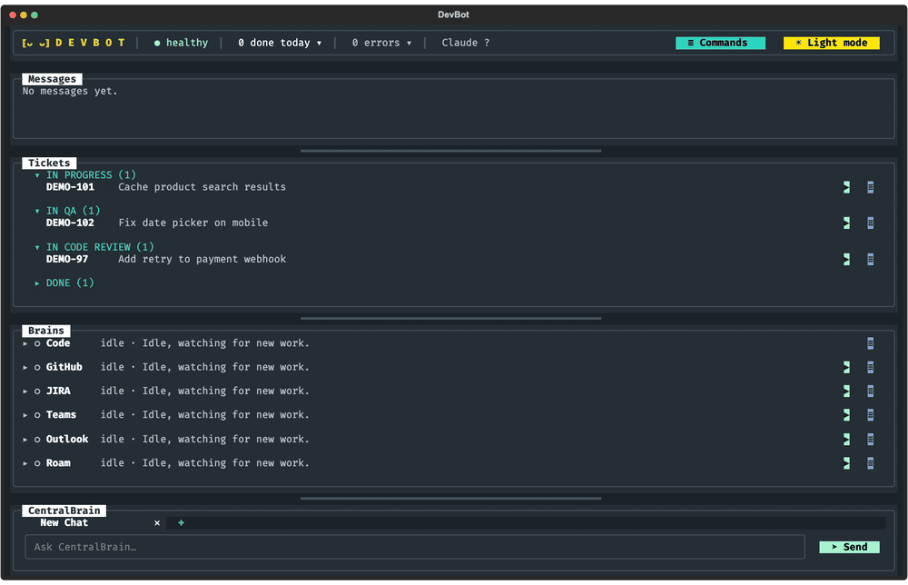
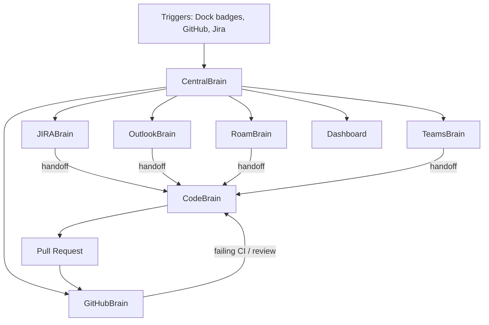

# DevBot


DevBot is an autonomous engineering assistant: six Claude Code engines that work your Jira tickets, GitHub PRs, Teams, Outlook and Roam for you, supervised by a seventh and run from one terminal dashboard.
Python orchestrates and keeps state; headless Claude Code does the work through the MCP connectors already set up on your machine.

---

## Table of Contents

- [Features](#features)
- [Demo](#demo)
- [Story](#story)
- [Results & Impact](#results--impact)
- [Tech Stack](#tech-stack)
- [Architecture](#architecture)
- [Getting Started](#getting-started)
- [Usage](#usage)
- [Folder Structure](#folder-structure)
- [Details](#details)
- [Author](#author)
- [Acknowledgments](#acknowledgments)

---

## Features

- Ticket to PR: picks up assigned Jira tickets, implements them in a git worktree, opens a PR with screenshots, and fixes CI and merge conflicts until it is green.
- Ticket lifecycle: moves tickets through IN QA, IN CODE REVIEW and DONE as PRs open, pass CI and merge, and posts updates to Teams.
- Inbox handling: reads Teams, Outlook and Roam, replies in your voice in the same thread, and turns requests into tickets.
- Meetings: joins Roam and Teams calls, transcribes locally with whisper.cpp, answers when you're addressed, and writes the minutes.
- Self-developing: ask CentralBrain for a change to DevBot and it edits, tests and commits its own code, then reloads.
- One dashboard: health, spend, ticket queue, messages and per-engine controls in a Textual terminal UI.

---

## Demo


---

## Story

DevBot started as a way to stop context-switching between Jira, GitHub, Teams, Outlook and Roam all day.
Instead of one large agent, each channel gets a small engine with one duty and its own memory, and a supervisor watches them, so a stuck engine never blocks the rest.

---

## Results & Impact

- Tickets move from assigned to PR with passing CI without manual steps.
- Messages and review comments get an answer within minutes, in the thread they came from.
- Every meeting gets minutes and action items, even Teams calls without Magic Minutes.
- Costs stay low: monitoring runs on Sonnet and only escalates to Opus when a judgment call or a reply is needed.

---

## Tech Stack

**AI & Orchestration**:
- Claude Code (headless `claude -p`)
- MCP connectors: Atlassian, Microsoft 365, Roam
- whisper.cpp for local transcription

**Backend**:
- Python 3.12
- Threads, JSON state files
- GitHub CLI (`gh`)
- Playwright / Chrome DevTools for Teams

**Frontend**:
- Textual terminal UI
- tmux

**Dev tools**:
- uv
- unittest
- Git & GitHub

---

## Architecture

**Flow**:
- Cheap triggers (no model call) wake an engine as soon as something changes.
- Each engine runs one headless Claude Code turn with its duty and memory.
- Work that needs code is handed to CodeBrain, which implements it in a worktree and opens a PR.
- GitHubBrain watches CI and reviews, hands failures back, and moves the Jira ticket along.
- CentralBrain restarts stuck engines, totals cost, and answers you in the dashboard chat.

---

## Getting Started

1. Clone the repository
```bash
git clone https://github.com/cjr03/DevBot.git
cd DevBot
```
2. Install dependencies (needs [uv](https://docs.astral.sh/uv/), [Claude Code](https://docs.anthropic.com/claude-code), `gh` and tmux)
```bash
uv sync
```
3. Connect the Atlassian, Microsoft 365 and Roam connectors in Claude Code, and sign in to `gh`.
4. Edit `config.json`:
```json
{
  "owner": "Your Name",
  "owner_email": "you@example.com",
  "repos_dir": "~/code",
  "teams_chats": ["Project Alpha"],
  "jira_url": "https://your-site.atlassian.net"
}
```
5. Run it
```bash
./devbot.sh
```
6. Run the tests
```bash
uv run python -m unittest discover -s tests
```

---

## Usage

- Start DevBot with `./devbot.sh`; closing the window only detaches the tmux session.
- Watch tickets, messages and engines in the dashboard; Pause, Stop, Run now and Retry are a click away.
- Ask CentralBrain anything: what an engine is doing, reply to someone, queue a ticket, or change DevBot itself.
- Keys: `Ctrl+Q` quit, `Ctrl+E` restart on new code, `Ctrl+N` new chat, `Ctrl+P` command list, `Ctrl+M` light/dark.

---

## Folder Structure

```plaintext
DevBot/
├─ devbot/
│  ├─ __main__.py      # entry point
│  ├─ brains.py        # engine duties and loops
│  ├─ bus.py           # shared state, queue, spend
│  ├─ claude.py        # headless Claude Code runs
│  ├─ graph.py         # tickets and messages views
│  ├─ meetings.py      # join, transcribe, answer, minutes
│  ├─ triggers.py      # cheap change detection
│  ├─ tracker.py       # Jira and GitHub lookups
│  ├─ awake.py         # keep the Mac awake and active
│  ├─ theme.py
│  └─ ui.py            # Textual dashboard
├─ tests/
│  └─ test_devbot.py
├─ docs/demo.gif
├─ config.json
├─ devbot.sh
├─ pyproject.toml
├─ README.md
└─ LICENSE
```

---

## Details

### Triggers

Every 3 seconds a cheap check (no Claude call) looks at the Dock badges, and every 30 seconds at the web APIs. Together they cover Teams, Outlook and Roam unread badges in the Dock, your GitHub notifications and PRs, and your most recently updated Jira ticket. When one changes, that brain runs immediately instead of waiting for its schedule. Jira credentials come from `credentials_env` in `config.json` (`state/credentials.env`, kept out of git).

### Staying awake and active

While DevBot runs it keeps the Mac awake (`caffeinate`) and, after 5 minutes with no keyboard or mouse input, wiggles the cursor and taps Shift so Roam and Teams keep you active. It never moves the cursor while you are using the Mac. Each nudge checks the system idle timer; if macOS ignored the input, RoamBrain logs an error asking you to grant Accessibility to your terminal app. This replaces the old `~/stayawake.sh` login agent. Lid-closed sleep still needs `sudo pmset -a disablesleep 1`.

When DevBot's code changes on disk, CentralBrain says so in chat. Press Ctrl+E to restart into the new version now.

### One-time Teams sign-in

The Microsoft 365 connector can read Teams but its send tool is off by default. DevBot therefore opens its own Chrome window (profile in `state/teams-chrome`, debugging port 9333) at Teams. Sign in there once; it stays signed in. TeamsBrain and JIRABrain post through that window, and CentralBrain tells you in chat if the sign-in expires.

If you enable the connector's Teams send tool in claude.ai connector settings, the brains use it instead and the window is only a fallback.

Tune `config.json`: intervals, JQL, Teams chat names, repo directory. There are no cost or time caps. Triggers wake a brain within seconds of new activity, even mid-run, when it goes again right after. The intervals are only a safety net, doubling once after a quiet run, and `min_gap_seconds` (10 minutes) is the least time between two model runs of one brain: wakes that come sooner fold into one run; Run now skips the wait. CodeBrain and the CentralBrain chat keep their Claude sessions across reloads. Tickets waiting for or being implemented by CodeBrain are saved in `state/queue.json` and resume after a restart. Per-brain memory lives in `state/<brain>.json` (Claude carries its own "already handled" lists there); logs in `logs/<brain>.log`.

Tests: `uv run python -m unittest discover -s tests`

### Limits

- **Cost routing:** monitoring brains sweep on Sonnet and do the bookkeeping themselves. Only when a reply someone will read, or a judgment call, is needed does the same session continue on Opus. CodeBrain's coding and the CentralBrain chat always use your default model.

### Dashboard extras

- **Per-brain control:** Pause holds one brain after its current run; Stop ends the run now (CodeBrain's ticket goes back in the queue); Resume continues it.
- **Spend:** the SPEND tile shows this session's spend, the spend of the last hour, and the all-time total. The total is saved in `state/spend.json`.
- **No attribution:** nothing DevBot writes credits Claude or AI. That covers messages, emails, meetings, tickets, PRs and commits. Claude Code's own co-author and PR trailers are switched off for every run.

### Meetings

- **Finding them:** OutlookBrain scans your calendar for the next 24 hours. TeamsBrain and RoamBrain catch invites in messages, including impromptu ones like "hop on Roam". Each meeting with a Roam or Teams join link goes into `state/meetings.json`.
- **Joining:** each calendar event is one meeting, joined in Roam or Teams depending on its location (Roam when the location names Roam or holds a Roam link, Teams when it names Teams, Roam when unclear). A minute before start, DevBot opens the link in that app and clicks Join (Join now in Teams) on the pre-join screen.
- **Listening and speaking:** during the meeting, Roam's output goes to BlackHole 2ch (so it can be transcribed) and a copy keeps playing on your speakers. Roam's microphone is BlackHole 16ch, which is where the reply is spoken. Audio is transcribed on this Mac by whisper.cpp. When someone says "Cole", Claude writes a short reply and the best installed macOS voice says it into the meeting. The transcript, including what was said for you, is in `state/live/<start>/transcript.txt`.
- **Leaving:** after goodbyes, after the scheduled end once the talking stops, after 10 minutes of silence, or 30 minutes past the end at the latest. Your normal audio devices are restored.
- **Teams notes:** Teams has no Magic Minutes, so after a Teams meeting DevBot writes its own notes from the local transcript. They go to `state/minutes/teams-<date>.md` with a summary, decisions, action items and open questions.
- **Magic Minutes:** after a Roam meeting, RoamBrain saves the summary, chapters, action items and transcript to `state/minutes/<meeting-id>.md` and DMs you a recap. Ask CentralBrain about any past meeting.
- **Briefings:** optional notes go in `state/briefings/<title-slug>.md`. Paragraphs starting with `PRIVATE` are stripped before Claude sees them.
- **Rules:** the reply and notes model runs with no tools, no connectors and an empty folder, because meeting audio is untrusted. It sees only the transcript, the briefing and a one-line status per brain. Replies never make commitments or share anything private. If someone sincerely asks whether they are talking to a person or an AI, the answer is honest.
- **One-time setup:** the RoamBrain log lists anything missing. Usually that's `brew install --cask blackhole-2ch blackhole-16ch` (asks for your password) and allowing Terminal under Privacy & Security, Accessibility. In Roam's and Teams' audio settings, use the system default devices. For a more natural voice, download an Enhanced or Premium English voice under Accessibility, Spoken Content. Set `meeting_voice` in `config.json` to pick one by name.

---

## Author

**Cole Roberts**

*M.S. Artificial Intelligence, Santa Clara University*

Email: cole03roberts@gmail.com

LinkedIn: https://www.linkedin.com/in/cole03roberts/

---

## Acknowledgments

Anthropic Claude Code and the Model Context Protocol.
Textual by Textualize.
whisper.cpp by Georgi Gerganov.
